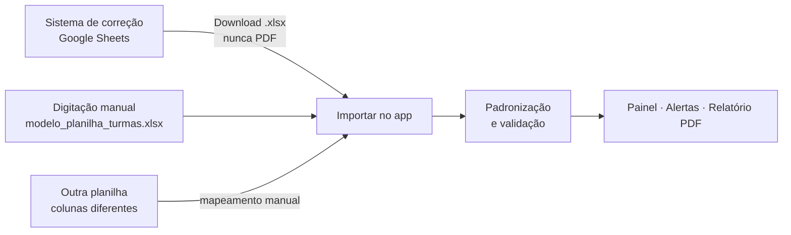
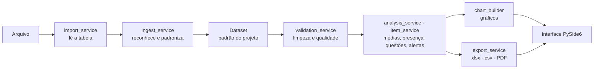

<div align="center">

# 📊 Métricas das Turmas

**Painel offline e gratuito para acompanhar o desempenho das turmas do cursinho em cada simulado.**


Projeto de extensão desenvolvido para o **cursinho popular da UFABC**.

[Como baixar e usar](#-guia-rápido-para-professores) ·
[Como preparar a planilha](#-como-preparar-a-planilha) ·
[Como ler os gráficos](#-como-ler-os-resultados) ·
[Para desenvolvedores](#-para-desenvolvedores)

</div>

---

## Sumário

1. [Sobre o projeto](#-sobre-o-projeto)
2. [Funcionalidades](#-funcionalidades)
3. [Guia rápido para professores](#-guia-rápido-para-professores)
4. [Como preparar a planilha](#-como-preparar-a-planilha)
5. [Como ler os resultados](#-como-ler-os-resultados)
6. [Problemas comuns](#-problemas-comuns)
7. [Para desenvolvedores](#-para-desenvolvedores)
8. [Regras de negócio](#-regras-de-negócio)
9. [Privacidade e segurança](#-privacidade-e-segurança)
10. [Equipe](#-equipe)
11. [Limitações e próximos passos](#-limitações-e-próximos-passos)
12. [Licença](#-licença)

---

## 🎯 Sobre o projeto

Depois de cada simulado, o sistema de correção entrega uma planilha com uma linha por aluno. Ler essa planilha à mão para responder perguntas como *"qual turma foi pior em Humanas?"* ou *"quais questões a turma mais errou?"* é lento e sujeito a erro.

O **Métricas das Turmas** lê a planilha, confere os dados e mostra o desempenho de cada turma em gráficos, tudo **no próprio computador, sem internet e sem custo**.

**O que o diferencia de uma planilha com gráficos:**

- **Aluno ausente não vira nota zero.** Nos dados reais do primeiro teste, 41% das linhas eram de ausentes: contá-los como 0% derrubava a média geral de 58% para 34%. O programa separa presença de desempenho.
- **Não acusa turma por acaso.** Turmas pequenas oscilam muito. A sinalização de "atenção" exige amostra mínima e diferença maior que a margem de erro.
- **Avisa quando a planilha tem problema** (lista de erros cortada, percentual inconsistente, cartão suspeito, possível erro de gabarito) em vez de calcular em silêncio.

<!-- Depois de tirar as capturas de tela, coloque os arquivos em docs/img/ e descomente:


-->

---

## ✨ Funcionalidades

| Área | O que faz |
|---|---|
| **Importação** | Lê `.xlsx`, `.xls`, `.ods`, `.csv` e `.txt`. Reconhece sozinho o layout do sistema de correção e o modelo do projeto. Qualquer outra planilha funciona por mapeamento manual de colunas. |
| **Painel** | Médias por turma (com margem de erro de 95%), distribuição das notas, dispersão (boxplot), comparação Linguagens × Humanas, evolução entre simulados, **presença** por turma e **questões mais erradas**. Filtros por turma, área e simulado. |
| **Alertas** | Alunos para conferir o cartão-resposta, questões com taxa de erro muito alta, problemas de qualidade da importação. |
| **Turmas em atenção** | Critério configurável (pontos abaixo da média geral e/ou média mínima), com amostra mínima e teste de margem de erro. O motivo de cada sinalização é sempre explicado. |
| **Exportação** | Dados tratados, resumo por turma (`.xlsx`/`.csv`), **relatório em PDF** (sem IDs de alunos) e a planilha convertida para o padrão do projeto. |
| **Padronização** | Converte qualquer exportação do sistema para uma planilha limpa, com fórmulas e validação de dados. |

---

## 🚀 Guia rápido para professores

Há duas formas de instalar. **A Opção 1 é a mais fácil e não exige Python nem VS Code.**

### Opção 1 — Instalador pronto (recomendado)

1. Abra a página de versões: <https://github.com/lauandanobre/Dashboard-Desempenho-De-Turmas/releases>
2. Na versão mais recente, em **Assets**, baixe **`Instalador_Metricas_das_Turmas.exe`**.
3. Dê dois cliques, avance (*Avançar → Instalar → Concluir*) e marque **"Criar atalho na área de trabalho"**. Não pede senha de administrador.
4. Abra o programa pelo atalho **Metricas das Turmas**. Para testar, importe o `exemplo_ficticio.xlsx` da pasta **Documentos\Metricas das Turmas** (o instalador copia para lá também o `modelo_planilha_turmas.xlsx`).

> ⚠️ **Aviso do Windows:** como o instalador não tem assinatura digital paga, o Windows pode mostrar *"O Windows protegeu seu computador"*. Clique em **Mais informações → Executar assim mesmo**. Alguns antivírus também podem estranhar o arquivo; ele é seguro e o código-fonte está neste repositório.
>
> Prefere sem instalar? Na mesma página, baixe **`Metricas_das_Turmas_portatil.zip`**, extraia e abra `MetricasDasTurmas.exe`.
>
> O primeiro uso pode demorar alguns segundos para abrir; o programa é grande (~400–700 MB instalado) porque leva junto o motor dos gráficos.

### Opção 2 — Pelo código-fonte (precisa do Python)

Use esta se não houver instalador publicado ainda. Você só precisa fazer a **instalação uma vez**.

#### Passo 1 — Instalar o Python (uma vez)

1. Acesse [python.org/downloads](https://www.python.org/downloads/) e baixe o **Python 3.12** (ou mais novo; precisa ser 3.10 ou superior).
2. Abra o instalador e, **na primeira tela, marque a caixa “Add Python to PATH”**. Depois clique em *Install Now*.

#### Passo 2 — Baixar o programa

1. Abra a página do projeto no GitHub: <https://github.com/lauandanobre/Dashboard-Desempenho-De-Turmas>
2. Clique no botão verde **Code → Download ZIP**.
3. Extraia o ZIP (clique com o botão direito → *Extrair tudo*) em uma pasta fácil de achar, como `C:\Metricas-Turmas`.

#### Passo 3 — Instalar as bibliotecas (uma vez)

Na pasta extraída, dê **dois cliques em `instalar.bat`** e espere aparecer **PRONTO!** (leva alguns minutos). Para conferir se nenhum arquivo ficou faltando, use antes **`verificar_projeto.bat`**.

#### Passo 4 — Abrir o programa (sempre que for usar)

Dê **dois cliques em `abrir.bat`**. A janela do programa abre. Para **testar sem dados reais**, clique em **Importar planilha** e escolha `assets\exemplo_ficticio.xlsx`.

> Prefere o terminal? Dentro da pasta: `python -m venv .venv`, `.venv\Scripts\activate`, `pip install -r requirements.txt` e `python main.py`.

### Usar com a planilha do simulado (vale para as duas opções)

1. No sistema de correção (Google Sheets), vá em **Arquivo → Fazer download → Microsoft Excel (.xlsx)**.
   **⚠ Nunca baixe em PDF:** o PDF corta a coluna “Questões Erradas” e a análise por questão fica errada.
2. No programa, clique em **Importar planilha** e escolha o arquivo.
3. O programa mostra o que reconheceu e o que corrigiu. Confira o resumo e confirme.
4. Navegue pelas abas **Dashboard**, **Dados**, **Alertas** e **Relatórios**.
5. Em **Relatórios**, gere o **PDF** para compartilhar com a coordenação.

---

## 📋 Como preparar a planilha

Existem **três jeitos** de os dados entrarem no programa:



### 1. Exportação do sistema de correção (o caminho normal)

O programa reconhece sozinho as colunas `ID, TURMA, Respostas, Acertos, Percentual, %Linguagens, %Humanas, Questões Erradas`. Em *Questões Erradas*, `Q12(B/C)` significa: na questão 12 o aluno marcou **B** e a correta era **C**.

### 2. Modelo do projeto (para digitar ou arquivar)

Use `assets/modelo_planilha_turmas.xlsx` (se instalou pelo instalador, ele está em **Documentos\Metricas das Turmas**). Na aba **Alunos**, só as colunas em **azul** são digitadas; as **cinzas** são fórmulas.

| Coluna | Digitar? | Regra |
|---|:---:|---|
| `turma` | ✅ | Código sempre igual (`T1NOTSA`, `VESPSBC`…) |
| `id_aluno` | ✅ | Único na turma + simulado. **Sem nome** (LGPD) |
| `simulado` | ✅ | Ex.: `S2D1`. Permite comparar simulados |
| `presente` | ✅ | `SIM` ou `NAO` |
| `respostas` | ✅ | Quantas questões o aluno marcou (0–90) |
| `acertos_linguagens` | ✅ | Inteiro de 0 a 45. **Em branco se ausente** |
| `acertos_humanas` | ✅ | Inteiro de 0 a 45. **Em branco se ausente** |
| `acertos_total`, `pct_linguagens`, `pct_humanas`, `pct_total` | ❌ | Fórmulas (0 a 100, sem `%`) |
| `observacao` | opcional | Texto livre |

Outras abas: **Gabarito** (letra correta de cada questão), **Config** (nº de questões por área) e **Erros** (opcional: uma linha por questão errada).

### Regras de ouro

1. **Ausente = `presente: NAO` e notas em branco. Nunca digite 0.**
2. **Nunca use PDF** como fonte de dados.
3. Notas são números de 0 a 100 **sem o símbolo `%`**.
4. Escreva o código da turma **sempre igual** em todos os arquivos.
5. Um arquivo por simulado, nomeado `AAAA-MM_simulado_S#D#.xlsx` (ex.: `2026-10_simulado_S2D1.xlsx`).
6. Sem células mescladas, linhas em branco no meio ou totais no rodapé.

Para converter uma exportação do sistema para o padrão: no programa, **Relatórios → Exportar no padrão da planilha**, ou pelo terminal:

```bash
python scripts/converter_planilha.py entrada.xlsx saida.xlsx
```

---

## 📈 Como ler os resultados

| Gráfico | Para que serve | Como interpretar |
|---|---|---|
| **Médias por turma** | Comparar turmas | A barra é a média. O “bigode” é a margem de erro de 95%: **se os bigodes de duas turmas se sobrepõem, a diferença pode ser só acaso.** |
| **Distribuição** | Ver como as notas se espalham | Pico à esquerda = muitos alunos com nota baixa. |
| **Dispersão (boxplot)** | Ver variação dentro da turma | A caixa guarda os 50% do meio. Caixa larga = turma desigual. |
| **Comparação por área** | Linguagens × Humanas | Mostra em qual área cada turma está mais fraca. |
| **Evolução** | Acompanhar simulados | Só aparece com 2 ou mais simulados. |
| **Presença** | Ver quem compareceu | Presentes × ausentes por turma. |
| **Questões mais erradas** | Rever conteúdo e gabarito | Passe o mouse para ver o gabarito e a alternativa errada mais marcada. Erro muito alto pode ser questão difícil **ou erro de gabarito**. |

### Aba Alertas

Pontos para **conferir antes de tirar conclusões**. Não são julgamentos sobre alunos ou turmas.

| Alerta | Quando aparece |
|---|---|
| Abaixo do acaso | Respondeu ≥ 60% da prova e acertou < 20% (chutar em 5 alternativas daria ~20%). Confira o cartão ou a versão da prova. |
| Mesma alternativa em excesso | ≥ 60% dos erros na mesma letra (o normal é 25–35%). |
| Sequência | 6 ou mais erros seguidos na mesma letra. |
| Percentual inconsistente | O percentual do sistema não bate com os acertos. O programa recalcula e avisa. |
| Questão com erro alto | 70% ou mais dos alunos erraram. Vale revisar gabarito ou anulação. |
| Lista de erros incompleta | Típico de PDF. Esses alunos ficam fora do ranking de questões. |

---

## 🛠 Problemas comuns

| Sintoma | Solução |
|---|---|
| `python` não é reconhecido | Reinstale o Python marcando **“Add Python to PATH”**, ou use `py` no lugar de `python`. |
| Erro de “execução de scripts desabilitada” ao ativar o ambiente | No PowerShell, rode uma vez `Set-ExecutionPolicy -Scope CurrentUser RemoteSigned` e responda `S`. |
| `ModuleNotFoundError: PySide6` (ou pandas) | O ambiente não está ativo. Rode `.venv\Scripts\activate` e confirme que aparece `(.venv)` no começo da linha. |
| Erro estranho logo ao abrir (modo código-fonte) | Pode ser Python antigo. Confira com `python --version`: precisa ser **3.10 ou superior**. |
| “O Windows protegeu seu computador” ao abrir o instalador | Clique em **Mais informações → Executar assim mesmo** (o instalador não tem assinatura digital paga). |
| A janela não aparece | Olhe a barra de tarefas: ela pode abrir atrás de outras janelas. |
| “Arquivo em uso” ao exportar | Feche o arquivo no Excel e exporte de novo. |
| “Layout não reconhecido” / “Faltam colunas” | Use o modelo `assets/modelo_planilha_turmas.xlsx` ou o mapeamento manual de colunas na importação. |
| Médias parecem baixas demais | Confira se ausentes estão com notas em **branco** (não 0) e se há coluna de presença. |

---

## 👩‍💻 Para desenvolvedores

### Instalação

```bash
git clone https://github.com/lauandanobre/Dashboard-Desempenho-De-Turmas.git
cd Dashboard-Desempenho-De-Turmas

python -m venv .venv                 # Linux/macOS: python3 -m venv .venv
.venv\Scripts\activate               # Windows
source .venv/bin/activate            # Linux/macOS

pip install -r requirements-dev.txt  # inclui pytest e pyinstaller
python main.py
```

Para rodar os testes: `python -m pytest -q` (esperado: **17 passed**). Os testes usam apenas dados **fictícios** gerados em código.

No VS Code: instale a extensão **Python**, use `Ctrl+Shift+P → Python: Select Interpreter` e escolha o `.venv`.

### Tecnologias

| Biblioteca | Papel no projeto |
|---|---|
| `PySide6` | Interface gráfica (janelas, abas, botões e diálogos). |
| `pandas` | Leitura, limpeza, validação e cálculo das médias. |
| `plotly` | Gráficos interativos (barras, histograma, boxplot, evolução). |
| `openpyxl` | Leitura e geração de `.xlsx` (inclui o modelo com fórmulas). |
| `xlrd` | Leitura de `.xls` antigos. |
| `odfpy` | Leitura de `.ods` (LibreOffice). |
| `pytest` | Testes automatizados. |
| `pyinstaller` | Empacota o programa em executável (`.exe`) para os professores. |

Tudo é gratuito: PySide6 (LGPL), pandas e openpyxl (BSD/MIT), Plotly (MIT).

### Arquitetura



A interface chama os serviços; os serviços ficam responsáveis pela lógica de dados e não dependem de Qt (por isso são testáveis).

### Estrutura de pastas

```text
main.py                         ponto de entrada
abrir.bat / instalar.bat        abrir e instalar o programa no Windows (modo código-fonte)
verificar_projeto.bat           confere se todos os arquivos estão presentes
build_windows.bat               gera o executável (.exe)
MetricasTurmas.spec             receita do PyInstaller
.github/workflows/              testes automáticos e build do instalador
assets/                         modelo_planilha_turmas.xlsx, exemplo_ficticio.(csv|xlsx)
scripts/                        gerar_modelo.py, gerar_dados_ficticios.py, converter_planilha.py
installer/                      instalador.iss (Inno Setup)
src/
  models/                       dataset, session, resultados e configurações
  services/
    schema.py                   definição do padrão de planilha (fonte única de verdade)
    import_service.py           leitura de arquivos (csv, xlsx, xls, ods, txt)
    ingest_service.py           reconhece layout e converte para o padrão
    validation_service.py       mapeamento de colunas, limpeza e qualidade
    analysis_service.py         médias, filtros, presença, turmas em atenção
    item_service.py             gabarito, ranking de questões e alertas
    export_service.py           exportação de dados, resumo e PDF
    standard_workbook.py        gera o modelo e a planilha padronizada
    demo_data.py                dados fictícios para exemplos e testes
  charts/                       gráficos Plotly
  ui/                           dashboard, dados, alertas, relatórios, diálogos
  utils/                        caminhos, log e utilidades
tests/                          pytest
```

### Fluxo da aplicação

```text
arquivo → import_service → ingest_service → ImportDialog → build_clean_dataset → Session → UI
```

### Comandos úteis

```bash
python scripts/gerar_modelo.py              # recria assets/modelo_planilha_turmas.xlsx
python scripts/gerar_dados_ficticios.py     # recria os exemplos fictícios
python scripts/converter_planilha.py in.xlsx out.xlsx
python -m pytest -q                         # testes
```

### Gerar o executável e o instalador

**No seu computador (Windows):** dê dois cliques em `build_windows.bat`. Ele cria o ambiente, roda os testes e gera `dist\MetricasDasTurmas\MetricasDasTurmas.exe`. Para criar também o instalador, instale o [Inno Setup 6](https://jrsoftware.org/isdl.php) (gratuito), abra `installer\instalador.iss` e aperte **F9**.

**Pelo GitHub (sem instalar nada):**

1. Vá em **Actions → Gerar executavel e instalador (Windows) → Run workflow**. O resultado fica em *Artifacts*.
2. Para **publicar uma versão** para os professores, crie uma tag: na página do repositório, **Releases → Draft a new release → Choose a tag**, digite `v1.0.0`, e publique. O GitHub gera o instalador e o `.zip` portátil e os anexa à versão automaticamente.

Os testes também rodam sozinhos a cada *push* (workflow **Testes**). A receita do PyInstaller está em `MetricasTurmas.spec`; o ícone é `assets/icon.ico` (substitua pelo do cursinho quando houver).

### Como contribuir

1. Crie uma branch por tarefa: `git checkout -b feature/nome-da-tarefa`.
2. Rode `python -m pytest -q` antes de abrir o *pull request*.
3. **Nunca versione dados reais de alunos.** O `.gitignore` já bloqueia `dados_reais/`, PDFs e `.xlsx` fora de `assets/`.
4. Mantenha a lógica de dados em `src/services/` e a interface em `src/ui/`.
5. Documente mudanças relevantes neste README.

---

## 📐 Regras de negócio

- **Formatos numéricos aceitos:** `75`, `75.5`, `75,5`, `75,5%` e `1.234,5`. Textos ambíguos são ignorados e listados para revisão.
- **Intervalo válido:** 0 a 100 (ajustável ou desativável na importação).
- **Ausentes:** não entram em nenhuma média. Vêm de `presente = NAO`, de `Respostas = 0` (layout do sistema) ou, em planilhas sem coluna de presença, da opção “tratar notas 0 como ausente”.
- **Linhas sem turma** são descartadas com aviso. **Células vazias** não entram na média.
- **IDs repetidos** podem ser mantidos com aviso ou removidos.
- **Turmas com nomes diferentes só por maiúsculas/minúsculas** não são unidas automaticamente.
- **Média geral** = média de todos os valores válidos do recorte (não é média de médias).
- **Turma em atenção:** média abaixo da geral da mesma área por X pontos (padrão: 5) e/ou abaixo de um mínimo absoluto. Exige no mínimo 10 registros e que a diferença supere a margem de erro de 95% (`±1,96 × erro padrão`).
- **Ranking de questões:** usa apenas alunos presentes com lista de erros completa (`respostas − acertos` = erros listados). O gabarito é deduzido dos pares *marcada/correta* quando a aba Gabarito está vazia.
- **Prova:** 90 questões, sendo Q1–Q45 Linguagens e Q46–Q90 Humanas (ajustável na aba `Config`).

---

## 🔒 Privacidade e segurança

- Tudo roda **localmente**. Nenhum dado é enviado a serviços externos.
- Os logs não gravam nomes, notas nem conteúdo das planilhas.
- Gráficos usam pasta temporária, limpa ao fechar o programa.
- Fórmulas e macros das planilhas **não são executadas**.
- Exportações neutralizam células que começam com `=`, `+`, `-` ou `@` (injeção de fórmulas).
- O relatório em PDF **não mostra IDs de alunos**. Apenas a aba Alertas (na tela) lista IDs.
- A planilha usa **ID numérico, sem nome** (LGPD). Mantenha dados reais fora do repositório.

---

## 👥 Equipe

**[Nome da equipe]**: Gabriely Alves · Lauanda Santos · Monyse Andrade · Lars Tatebe · Felipe Pellizzari

**Orientação / cursinho:** Joeldson de Souza Gama · **Instituição:** Universidade Federal do ABC (UFABC)

---

## 🧭 Limitações e próximos passos

**Limitações conhecidas**

- O ranking de questões depende de a planilha trazer a lista completa de erros. Em PDF ela vem cortada.
- Como a planilha lista só as questões **erradas**, questões em branco e acertos não são distinguíveis em alunos que não responderam tudo.
- Com poucos alunos por turma (< 10), o programa não avalia a turma de propósito.
- O significado dos códigos de turma (`T1NOTSA` etc.) deve ser confirmado com a coordenação. O rótulo do simulado (`S2D1`) é deduzido do nome do arquivo quando ele segue o padrão `S#D#`; senão, a coluna `simulado` fica vazia.

**Próximos passos**

- [x] Receita do executável e do instalador (PyInstaller + Inno Setup) prontas.
- [ ] Publicar a primeira versão (*Release*) e validar o instalador no Windows.
- [ ] Trocar o ícone provisório (`assets/icon.ico`) pela identidade visual do cursinho.
- [ ] Capturas de tela na seção de apresentação (`docs/img/`).
- [ ] Validar exportação de gráficos em PNG no macOS e no Linux.
- [x] Integração contínua (GitHub Actions) rodando os testes a cada *push*.

---

## 📄 Licença

Distribuído sob a licença **MIT**. Veja o arquivo [`LICENSE`](LICENSE).
